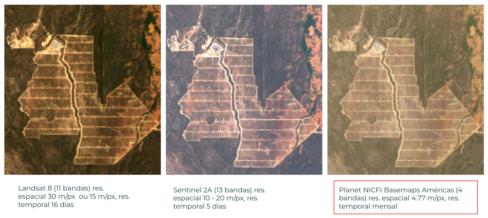
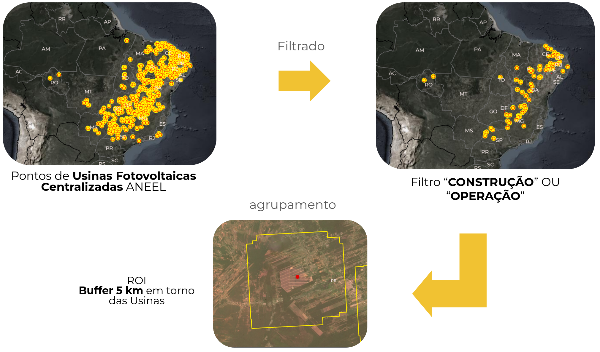
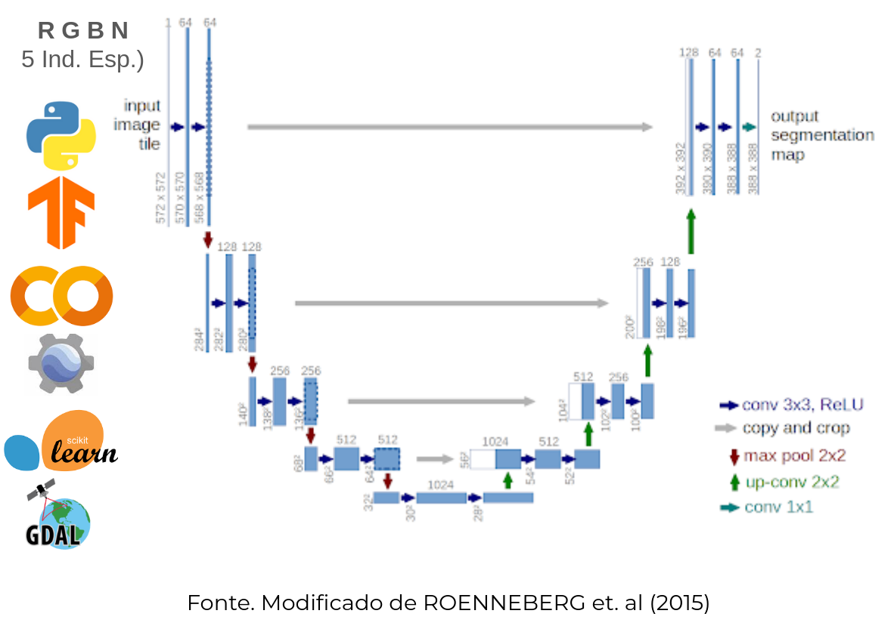
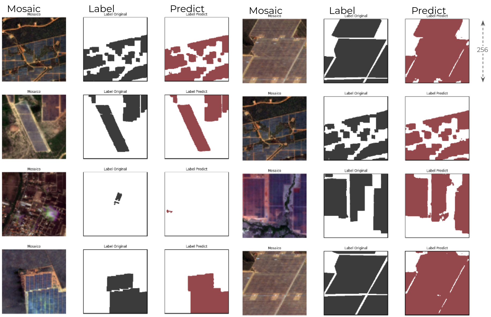

# Photovoltaic Power Plant Mapping with Deep Learning

> Methodology for mapping areas occupied by Photovoltaic Power Plants in Brazil using semantic segmentation with convolutional neural networks (U-Net) on high-resolution Planet NICFI imagery.

Produced by **[Geodatin - Data and Geoinformation](https://geodatin.com)** · GPLv2 License

---

## Overview

This repository documents the complete pipeline for the annual mapping (2015–2024) of centralized photovoltaic power plants in Brazil, integrating:

- Image collection and preprocessing via **Google Earth Engine (GEE)**
- Labeled sample generation from **ANEEL** data
- **U-Net** model training with **TensorFlow/Keras** on Google Colab
- Batch inference over regions of interest
- Post-processing and export to GEE assets and GeoTIFF files
- Area analysis crossed with **MapBiomas** (Collection 9/10)

---

## Input Data

### Satellite Imagery — Planet NICFI Basemaps

After comparing the main available imagery sources, the project adopted **Planet NICFI Basemaps** as the primary input:



| Sensor      | Bands | Spatial Res. | Temporal Res. |
|----------   |-------|--------------|---------------|
| Landsat 8   | 11    | 30 m / 15 m  | 16 days       |
| Sentinel-2A | 13    | 10–20 m      | 5 days        |
| **Planet NICFI** | **4 (B, G, R, N)** | **4.77 m** | **Monthly** |

The ~5 m spatial resolution of Planet NICFI enables detection of individual panels and small-scale plants, which is not feasible with Landsat or Sentinel.

### Computed Spectral Indices

From the 4 Planet bands, 5 additional spectral indices are derived, yielding **9 input channels** for the model:

| Symbol | Description | Formula |
|---|---|---|
| `iia` | Anthropogenic Impact Index | `(G − 4·N) / (G + 4·N)` |
| `evi` | Enhanced Vegetation Index | `2.4 · (N − R) / (1 + N + R)` |
| `ri` | Redness Index | `2.4 · (R − G) / (R + G)` |
| `gli` | Green Leaf Index | `(2G − R − B) / (2G + R + B)` |
| `shape` | Shape Index | `(2R − G − B) / (G − B)` |

### Ground Reference — ANEEL

Sampling areas are defined from **Centralized Photovoltaic Power Plant** points provided by ANEEL, filtered by status **"CONSTRUÇÃO"** (under construction) or **"OPERAÇÃO"** (in operation), with a **5 km buffer** around each plant to define the Region of Interest (ROI).



---

## Model Architecture — U-Net

The semantic segmentation model is based on the **U-Net** architecture (Ronneberger et al., 2015), adapted for 9-band multispectral input and 256×256 pixel patches.



```
Input:  (256, 256, 9)  →  B, G, R, N, iia, evi, ri, gli, shape
Output: (256, 256, 1)  →  binary mask (photovoltaic / non-photovoltaic)
```

### Training Configuration

| Parameter | Value |
|---|---|
| Framework | TensorFlow 2.17.1 / Keras |
| Environment | Google Colab (GPU) |
| Batch size | 12 |
| Epochs | 150 |
| Steps/epoch | 200 |
| Optimizer | Adam (lr = 1e-3) |
| Loss | BinaryCrossentropy |
| Metric | MeanIoU |
| Decision threshold | 0.8 |
| Data format | TFRecord (.gz) |

Trained model weights are available in [src/models/](src/models/):
- `model_07_12_2024.keras`
- `model_10_12_2024.keras`

---

## Prediction Examples

The figure below shows 256×256 patch examples with the original mosaic, the reference label, and the model prediction:



---

## Repository Structure

```
mapping_usinas_fotovoltaicas/
├── image/                              # Documentation figures
│   ├── Modelo_UNet.png
│   ├── area_samples_fotovoltaica.png
│   ├── inspections_predict_patchs.png
│   └── show_exemplo_FV_image_satelite.png
│
└── src/
    ├── configure_account_projects_ee.py    # GEE account configuration
    ├── gee_tools.py                        # GEE utilities (tasks, assets)
    │
    ├── show_colect_data/                   # GEE (JavaScript) scripts for visualization
    │   ├── coletaFotovoltaica_19_11.js
    │   ├── revisao_layer_fotovoltaica_2024.js
    │   ├── show_areas_to_predict_FV.js
    │   ├── show_colect_layersfromCNN_fotovoltaicaV2.js
    │   ├── show_images_TIF_or_npy.ipynb
    │   └── toolkitFotovoltaicaV4.js
    │
    ├── preprocessing/                      # Image preprocessing and download
    │   ├── downloadImgRegionsFotovoltaicas.py
    │   ├── fast_downloadImgbyRegionstoLocal.py
    │   ├── passo1_makeAmostra_Normalizado_GT_DL_fotoV.ipynb
    │   ├── split_tfrecord_dataset.py
    │   └── regions_G2_panel_with_bufferv2.json
    │
    ├── processClass/                       # Training, prediction and mapping
    │   ├── makeAmostra_Normalizado_GT_DL_fotoV.ipynb
    │   ├── treinamento_GT_DL_fotovoltaicaCaat.ipynb  ← U-Net training
    │   ├── PedrictUnetAttenty_fotovoltaicaCaat.ipynb
    │   ├── makeMaping_with_predictPatchs.ipynb       ← batch inference
    │   ├── makePredict_patchinServer_v1.py
    │   └── teste_read_model.py
    │
    ├── models/                             # Trained Keras models
    │   ├── model_07_12_2024.keras
    │   └── model_10_12_2024.keras
    │
    ├── posprocessing/                      # Post-processing
    │   ├── join_convert_npytoTIF.py        ← merge patches → GeoTIFF
    │   ├── filterTemporalLayer.py          ← temporal filter per region/year
    │   ├── uploadTIF_from_localFolder_GoogleStorage.py
    │   ├── transferTIF_fromGCSbucket_toGEEasset.py
    │   └── regions_G2_panel_with_bufferv2.json
    │
    ├── areas/                              # Area analysis
    │   ├── cruzamento_areas_map.py         ← cross with MapBiomas
    │   └── cruzamento_estados_map.py       ← cross with state boundaries
    │
    └── utieis_sripts/                      # Utility scripts
        ├── compretion_byYear.py
        ├── descomprimir_arq_tarqz.py
        ├── join_shps_FV.py
        ├── move_filesNPY_toFolder.py
        └── vetorizar_panels_regions.py
```

---

## Full Pipeline

```
┌─────────────────────────────────────────────────────────────────┐
│  1. SAMPLE COLLECTION (GEE)                                     │
│     ANEEL → status filter → 5km buffer → ROIs                  │
│     Planet NICFI + spectral indices → TFRecord patches          │
└────────────────────────┬────────────────────────────────────────┘
                         ▼
┌─────────────────────────────────────────────────────────────────┐
│  2. TRAINING (Google Colab + GPU)                               │
│     TFRecord (256×256×9) → U-Net → BinaryCrossentropy          │
│     Checkpoint on best val_MeanIoU → .keras                     │
└────────────────────────┬────────────────────────────────────────┘
                         ▼
┌─────────────────────────────────────────────────────────────────┐
│  3. BATCH INFERENCE                                             │
│     .npy patches per region → model → binary masks .npy        │
│     Threshold: prediction ≥ 0.8 → photovoltaic class           │
└────────────────────────┬────────────────────────────────────────┘
                         ▼
┌─────────────────────────────────────────────────────────────────┐
│  4. POST-PROCESSING                                             │
│     Merge patches → GeoTIFF (EPSG:3857, 4m)                    │
│     Upload to GCS → Transfer to GEE Asset                      │
│     Temporal filter (focalMax/focalMin) per region/year        │
└────────────────────────┬────────────────────────────────────────┘
                         ▼
┌─────────────────────────────────────────────────────────────────┐
│  5. AREA ANALYSIS                                               │
│     Cross with MapBiomas Col 9/10 by class and year            │
│     Aggregation by state (2015–2024)                            │
└─────────────────────────────────────────────────────────────────┘
```

---

## Dependencies

```bash
# Python
earthengine-api
tensorflow>=2.17
keras
rasterio
numpy
pandas
tqdm
opencv-python    # cv2
google-auth
google-api-python-client
```

### GEE Setup

```python
# Service account authentication
ee.Initialize(ee.ServiceAccountCredentials(sa, pem_path))

# Or user account
ee.Initialize(project='your-gee-project')
```

To switch between multiple GEE accounts, use the utility in [src/gee_tools.py](src/gee_tools.py):

```bash
python src/gee_tools.py user --new account_name
python src/gee_tools.py tasks --states opentasks
python src/gee_tools.py cancel --states opentasks
```

---

## Temporal and Spatial Coverage

- **Period**: 2015 to 2024 (annual time series)
- **Spatial resolution**: 4 m (Planet NICFI)
- **Coverage**: Brazil, with initial focus on the **Caatinga** biome
- **Output GEE assets**:
  - `projects/geo-data-s/assets/fotovoltaica/version_2` — raw predictions
  - `projects/geo-data-s/assets/fotovoltaica/version_2_clean` — after temporal filter

---

## References

- **U-Net**: Ronneberger, O., Fischer, P., & Brox, T. (2015). U-Net: Convolutional Networks for Biomedical Image Segmentation. *MICCAI 2015*. [arXiv:1505.04597](https://arxiv.org/abs/1505.04597)
- **Planet NICFI**: Norway's International Climate and Forests Initiative Satellite Data Program — [planet.com/nicfi](https://www.planet.com/nicfi/)
- **ANEEL**: Brazilian Electricity Regulatory Agency — Centralized Photovoltaic Power Plants Database
- **MapBiomas**: Collection 9 and 10 — [mapbiomas.org](https://mapbiomas.org)

---

## License

Distributed under the **GNU General Public License v2.0 (GPLv2)**. See the [LICENSE](LICENSE) file for details.
