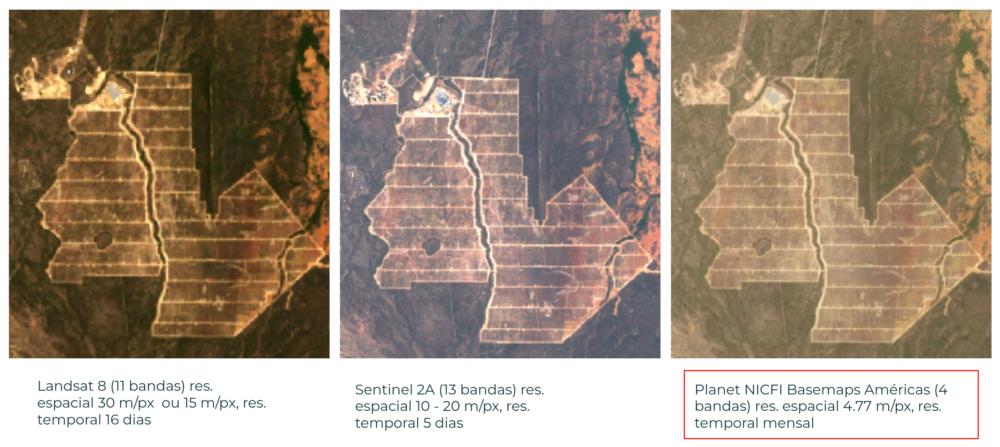
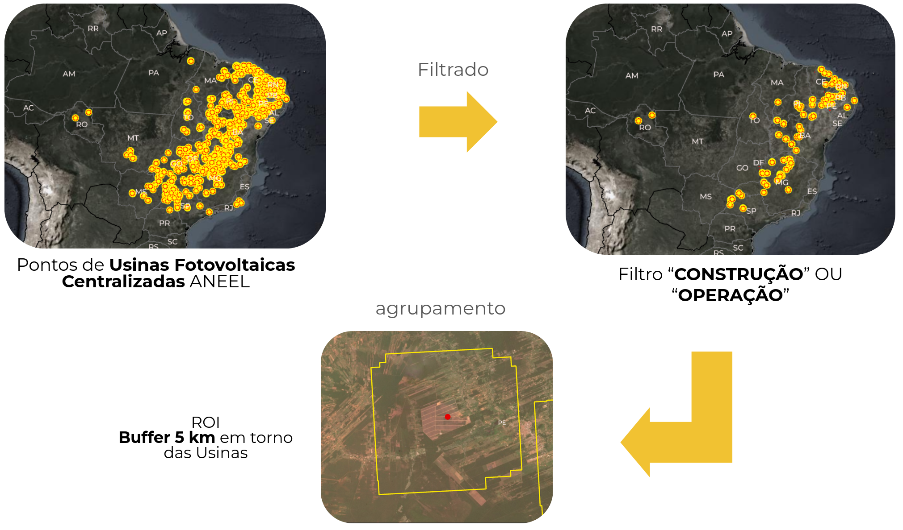
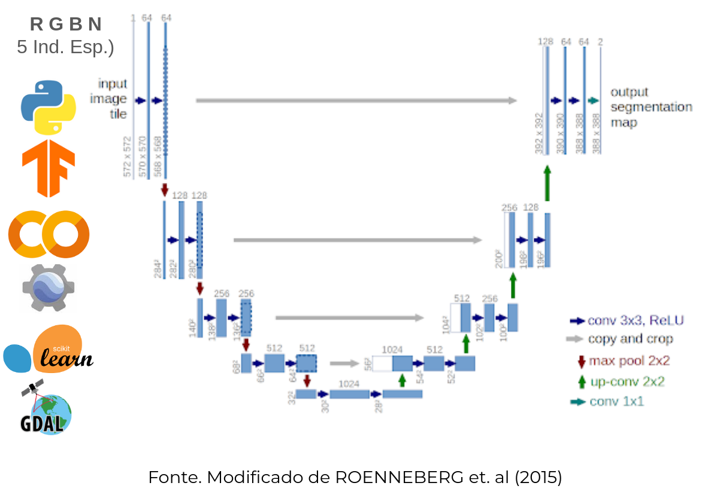
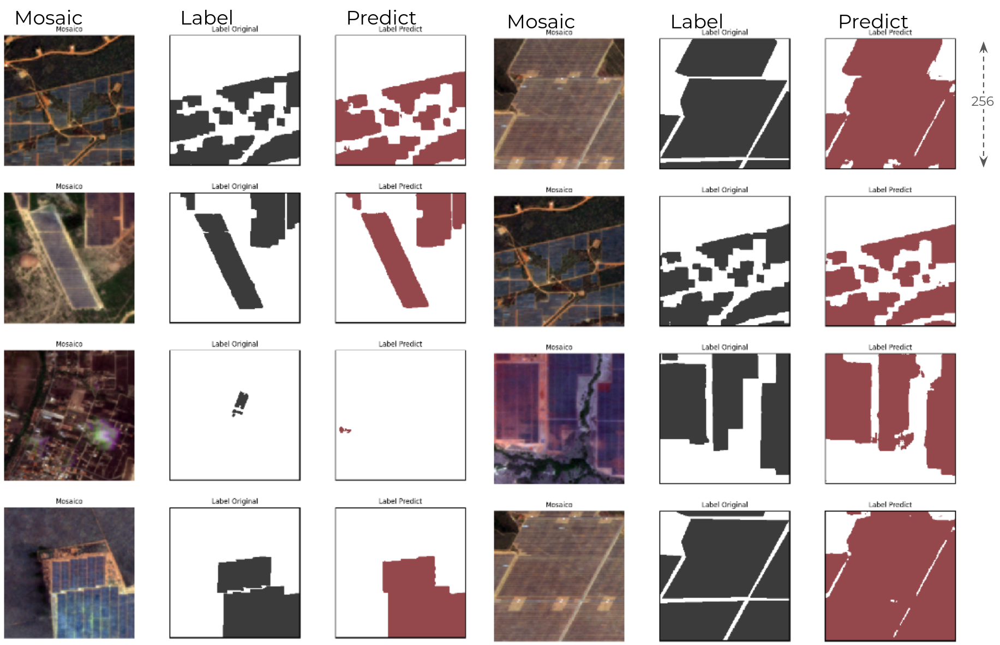

# Mapeamento de Usinas Fotovoltaicas com Deep Learning

> Metodologia de mapeamento das áreas ocupadas por Usinas Fotovoltaicas no Brasil utilizando segmentação semântica com redes neurais convolucionais (U-Net) sobre imagens de alta resolução do Planet NICFI.

Produzido por **[Geodatin - Dados e Geoinformação](https://geodatin.com)** · Licença GPLv2

---

## Visão Geral

Este repositório documenta o pipeline completo para o mapeamento anual (2015–2024) de usinas fotovoltaicas centralizadas no Brasil, integrando:

- Coleta e pré-processamento de imagens via **Google Earth Engine (GEE)**
- Geração de amostras rotuladas a partir de dados da **ANEEL**
- Treinamento de um modelo **U-Net** com **TensorFlow/Keras** no Google Colab
- Inferência em lote por regiões de interesse
- Pós-processamento e exportação para ativos GEE e arquivos GeoTIFF
- Análise de áreas cruzadas com o **MapBiomas** (Coleção 9/10)

---

## Dados de Entrada

### Imagens de Satélite — Planet NICFI Basemaps

Após comparação entre as principais fontes de imagens disponíveis, o projeto adotou o **Planet NICFI Basemaps** como dado de entrada principal:



| Sensor | Bandas | Res. Espacial | Res. Temporal |
|---|---|---|---|
| Landsat 8 | 11 | 30 m / 15 m | 16 dias |
| Sentinel-2A | 13 | 10–20 m | 5 dias |
| **Planet NICFI** | **4 (B, G, R, N)** | **4,77 m** | **Mensal** |

A resolução espacial de ~5 m do Planet NICFI permite a detecção de painéis individuais e usinas de pequeno porte, o que não é viável com Landsat ou Sentinel.

### Índices Espectrais Calculados

A partir das 4 bandas do Planet são derivados 5 índices espectrais adicionais, totalizando **9 canais de entrada** para o modelo:

| Símbolo | Descrição | Fórmula |
|---|---|---|
| `iia` | Índice de Impacto Antrópico | `(G − 4·N) / (G + 4·N)` |
| `evi` | Enhanced Vegetation Index | `2.4 · (N − R) / (1 + N + R)` |
| `ri` | Redness Index | `2.4 · (R − G) / (R + G)` |
| `gli` | Green Leaf Index | `(2G − R − B) / (2G + R + B)` |
| `shape` | Shape Index | `(2R − G − B) / (G − B)` |

### Referência de Campo — ANEEL

As áreas de amostragem são definidas a partir dos pontos de **Usinas Fotovoltaicas Centralizadas** da ANEEL, filtrados pelos status **"CONSTRUÇÃO"** ou **"OPERAÇÃO"**, com um buffer de **5 km** em torno de cada usina para definir a Região de Interesse (ROI).



---

## Arquitetura do Modelo — U-Net

O modelo de segmentação semântica é baseado na arquitetura **U-Net** (Roenneberg et al., 2015), adaptada para entrada multiespectral de 9 bandas e patches de 256×256 pixels.



```
Entrada: (256, 256, 9)  →  B, G, R, N, iia, evi, ri, gli, shape
Saída:   (256, 256, 1)  →  máscara binária (fotovoltaico / não-fotovoltaico)
```

### Configuração do Treinamento

| Parâmetro | Valor |
|---|---|
| Framework | TensorFlow 2.17.1 / Keras |
| Ambiente | Google Colab (GPU) |
| Batch size | 12 |
| Epochs | 150 |
| Steps/epoch | 200 |
| Optimizer | Adam (lr = 1e-3) |
| Loss | BinaryCrossentropy |
| Métrica | MeanIoU |
| Limiar de decisão | 0.8 |
| Formato dos dados | TFRecord (.gz) |

Os pesos dos modelos treinados estão disponíveis em [src/models/](src/models/):
- `model_07_12_2024.keras`
- `model_10_12_2024.keras`

---

## Exemplos de Predição

A figura abaixo mostra exemplos de patches 256×256 com o mosaico original, o label de referência e a predição do modelo:



---

## Estrutura do Repositório

```
mapping_usinas_fotovoltaicas/
├── image/                              # Figuras de documentação
│   ├── Modelo_UNet.png
│   ├── area_samples_fotovoltaica.png
│   ├── inspections_predict_patchs.png
│   └── show_exemplo_FV_image_satelite.png
│
└── src/
    ├── configure_account_projects_ee.py    # Configuração de contas GEE
    ├── gee_tools.py                        # Utilitários GEE (tarefas, assets)
    │
    ├── show_colect_data/                   # Scripts GEE (JavaScript) para visualização
    │   ├── coletaFotovoltaica_19_11.js
    │   ├── revisao_layer_fotovoltaica_2024.js
    │   ├── show_areas_to_predict_FV.js
    │   ├── show_colect_layersfromCNN_fotovoltaicaV2.js
    │   ├── show_images_TIF_or_npy.ipynb
    │   └── toolkitFotovoltaicaV4.js
    │
    ├── preprocessing/                      # Pré-processamento e download de imagens
    │   ├── downloadImgRegionsFotovoltaicas.py
    │   ├── fast_downloadImgbyRegionstoLocal.py
    │   ├── passo1_makeAmostra_Normalizado_GT_DL_fotoV.ipynb
    │   ├── split_tfrecord_dataset.py
    │   └── regions_G2_panel_with_bufferv2.json
    │
    ├── processClass/                       # Treinamento, predição e mapeamento
    │   ├── makeAmostra_Normalizado_GT_DL_fotoV.ipynb
    │   ├── treinamento_GT_DL_fotovoltaicaCaat.ipynb  ← treinamento U-Net
    │   ├── PedrictUnetAttenty_fotovoltaicaCaat.ipynb
    │   ├── makeMaping_with_predictPatchs.ipynb       ← inferência em lote
    │   ├── makePredict_patchinServer_v1.py
    │   └── teste_read_model.py
    │
    ├── models/                             # Modelos Keras treinados
    │   ├── model_07_12_2024.keras
    │   └── model_10_12_2024.keras
    │
    ├── posprocessing/                      # Pós-processamento
    │   ├── join_convert_npytoTIF.py        ← une patches → GeoTIFF
    │   ├── filterTemporalLayer.py          ← filtro temporal por região/ano
    │   ├── uploadTIF_from_localFolder_GoogleStorage.py
    │   ├── transferTIF_fromGCSbucket_toGEEasset.py
    │   └── regions_G2_panel_with_bufferv2.json
    │
    ├── areas/                              # Análise de área
    │   ├── cruzamento_areas_map.py         ← cruzamento com MapBiomas
    │   └── cruzamento_estados_map.py       ← cruzamento por estado
    │
    └── utieis_sripts/                      # Scripts utilitários
        ├── compretion_byYear.py
        ├── descomprimir_arq_tarqz.py
        ├── join_shps_FV.py
        ├── move_filesNPY_toFolder.py
        └── vetorizar_panels_regions.py
```

---

## Pipeline Completo

```
┌─────────────────────────────────────────────────────────────────┐
│  1. COLETA DE AMOSTRAS (GEE)                                    │
│     ANEEL → filtro status → buffer 5km → ROIs                  │
│     Planet NICFI + índices espectrais → TFRecord patches        │
└────────────────────────┬────────────────────────────────────────┘
                         ▼
┌─────────────────────────────────────────────────────────────────┐
│  2. TREINAMENTO (Google Colab + GPU)                            │
│     TFRecord (256×256×9) → U-Net → BinaryCrossentropy          │
│     Checkpoint por melhor val_MeanIoU → .keras                  │
└────────────────────────┬────────────────────────────────────────┘
                         ▼
┌─────────────────────────────────────────────────────────────────┐
│  3. INFERÊNCIA EM LOTE                                          │
│     Patches .npy por região → modelo → máscaras binárias .npy  │
│     Limiar: predição ≥ 0.8 → classe fotovoltaico               │
└────────────────────────┬────────────────────────────────────────┘
                         ▼
┌─────────────────────────────────────────────────────────────────┐
│  4. PÓS-PROCESSAMENTO                                           │
│     join patches → GeoTIFF (EPSG:3857, 4m)                     │
│     Upload GCS → Transfer para GEE Asset                       │
│     Filtro temporal (focalMax/focalMin) por região/ano         │
└────────────────────────┬────────────────────────────────────────┘
                         ▼
┌─────────────────────────────────────────────────────────────────┐
│  5. ANÁLISE DE ÁREA                                             │
│     Cruzamento com MapBiomas Col 9/10 por classe e ano         │
│     Agregação por estado (2015–2024)                            │
└─────────────────────────────────────────────────────────────────┘
```

---

## Dependências

```bash
# Python
earthengine-api
tensorflow>=2.17
keras
rasterio
numpy
pandas
tqdm
opencv-python    # cv2
google-auth
google-api-python-client
```

### Configuração do GEE

```python
# Autenticação por conta de serviço (SERVICE_ACCOUNT)
ee.Initialize(ee.ServiceAccountCredentials(sa, pem_path))

# Ou por conta de usuário
ee.Initialize(project='seu-projeto-gee')
```

Para alternar entre múltiplas contas GEE, use o utilitário em [src/gee_tools.py](src/gee_tools.py):

```bash
python src/gee_tools.py user --new nome_da_conta
python src/gee_tools.py tasks --states opentasks
python src/gee_tools.py cancel --states opentasks
```

---

## Cobertura Temporal e Espacial

- **Período**: 2015 a 2024 (série anual)
- **Resolução espacial**: 4 m (Planet NICFI)
- **Cobertura**: Brasil, com foco inicial no bioma **Caatinga**
- **Assets GEE de saída**:
  - `projects/geo-data-s/assets/fotovoltaica/version_2` — predições brutas
  - `projects/geo-data-s/assets/fotovoltaica/version_2_clean` — após filtro temporal

---

## Referências

- **U-Net**: Ronneberger, O., Fischer, P., & Brox, T. (2015). U-Net: Convolutional Networks for Biomedical Image Segmentation. *MICCAI 2015*. [arXiv:1505.04597](https://arxiv.org/abs/1505.04597)
- **Planet NICFI**: Norway's International Climate and Forests Initiative Satellite Data Program — [planet.com/nicfi](https://www.planet.com/nicfi/)
- **ANEEL**: Agência Nacional de Energia Elétrica — Base de Usinas Fotovoltaicas Centralizadas
- **MapBiomas**: Coleção 9 e 10 — [mapbiomas.org](https://mapbiomas.org)

---

## Licença

Distribuído sob a licença **GNU General Public License v2.0 (GPLv2)**. Consulte o arquivo [LICENSE](LICENSE) para mais detalhes.
